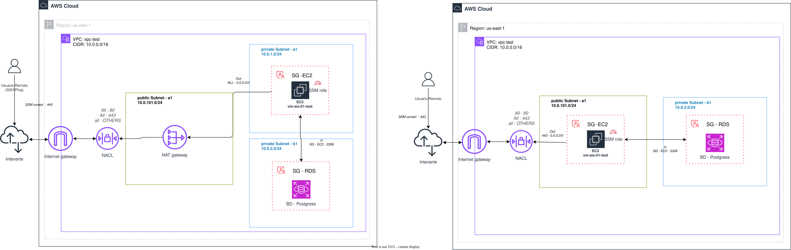

# Lab 7: RDS + EC2 + SSM

## Descripción

Este laboratorio despliega una infraestructura básica en AWS que permite conectarse a una instancia EC2 mediante AWS Systems Manager (SSM) Session Manager y acceder a una base de datos RDS MySQL en una subred privada. La arquitectura sigue mejores prácticas de seguridad al no exponer la base de datos a internet y evitar el uso de bastion hosts.

## Servicios AWS Utilizados

| Servicio | Descripción |
|----------|-------------|
| **VPC** | Red virtual con subredes públicas y privadas en 2 AZs |
| **EC2** | Instancia t3.micro para acceso vía SSM |
| **RDS** | Base de datos MySQL 8.0 en subred privada |
| **IAM** | Role y Instance Profile para SSM |
| **CloudWatch** | Flow logs de VPC |
| **S3** | Backend para estado de Terraform |
| **Security Groups** | Reglas de red para EC2 y RDS |

## Arquitectura



## Estructura del Proyecto

```
7_rds_ec2_ssm/
├── main.tf              # Configuración principal (módulos)
├── provider.tf          # Provider AWS y backend S3
├── vpc+rds+ec2.svg      # Diagrama de arquitectura
├── public/
│   ├── vpc/             # Módulo VPC (subredes, NACLs, flow logs)
│   ├── ec2/             # Módulo EC2 (instancia, SG, IAM SSM)
│   └── rds/             # Módulo RDS (MySQL, SG)
└── private/             # Módulos privados (comentados)
```

## Módulos

### VPC (`public/vpc`)

- **CIDR**: `10.0.0.0/16`
- **AZs**: `us-east-1a`, `us-east-1b`
- **Subredes públicas**: `10.0.101.0/24`
- **Subredes privadas**: `10.0.1.0/24`, `10.0.2.0/24`
- **NACLs**: Reglas para tráfico HTTP/HTTPS en subred pública
- **Flow Logs**: Envío de logs a CloudWatch (retención 7 días)

### EC2 (`public/ec2`)

- **Instancia**: `t3.micro`
- **Subnet**: Pública (`10.0.101.0/24`)
- **IP Pública**: Sí
- **Monitoring**: Habilitado
- **IAM**: Instance Profile con `AmazonSSMManagedInstanceCore`
- **Security Group**: Egress todo permitido, sin ingress (acceso vía SSM)

### RDS (`public/rds`)

- **Engine**: MySQL 8.0
- **Instancia**: `db.t3.micro`
- **Subnet**: Privada (`us-east-1b`)
- **Acceso público**: No
- **Almacenamiento**: 20 GB gp3, cifrado
- **Seguridad**: Solo acepta conexiones desde el Security Group de EC2
- **Multi-AZ**: No (entorno de desarrollo)
- **Skip final snapshot**: Sí (facilita destrucción en labs)

## Requisitos

- Terraform >= 1.0
- AWS Provider ~> 6.0
- Cuenta AWS con permisos para crear VPC, EC2, RDS, IAM, CloudWatch

## Uso

```bash
# Inicializar
terraform init

# Planificar
terraform plan

# Aplicar
terraform apply

# Destruir
terraform destroy
```

## Conexión a EC2 vía SSM

```bash
aws ssm start-session --target <instance-id>
```

## Conexión a RDS

Desde la EC2 (vía SSM):

```bash
mysql -h <rds-endpoint> -u admin -p
```

## Port Forwarding a RDS vía SSM

```bash
aws ssm start-session \
    --target <instance-id>\
    --document-name AWS-StartPortForwardingSessionToRemoteHost \
    --parameters '{"portNumber":["3306"],"localPortNumber":["3306"],"host":["<endpoint-rds>"]}'
```

## Notas de Seguridad

- La base de datos **no** es accesible públicamente
- El acceso a EC2 se realiza mediante SSM Session Manager (no requiere puerto 22 abierto)
- Los flow logs de VPC se envían a CloudWatch para monitoreo
- El estado de Terraform se almacena en S3 con lockfile
